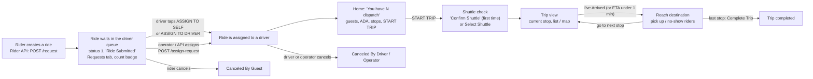

# Driver trip lifecycle — end-to-end test plan

Status: **Phases T1 to T7 are done and passing (T7 with the limits listed in its findings) (two T5 tests are written but skipped until the developer's fix, see below); T6 to T8 are planned only.** Nothing here has been run beyond what is marked *live*.
Scope: the on-demand (ASAP) driver on the staging build, from a ride arriving to the trip being completed, including positive, negative and corner cases.

**How to read the tables**

| Column | Meaning |
|---|---|
| **Type** | **P** positive (the normal way it works), **N** negative (something is refused or goes wrong), **C** corner (unusual, boundary, timing, state or real-time case) |
| **Pri** | P0 must-have for every build, P1 core, P2 secondary, P3 low value |
| **Evidence** | **LIVE** seen on staging in a real run or UI dump · **CODE** read in the app source, not yet seen live · **CONFIRM** the expected result is not defined anywhere and needs a product answer before it can be asserted |
| **Phase** | the automation phase (T1 to T8, see section 6) that will deliver it |

Scenario titles are written as a person would say them. IDs are only for traceability.

## Summary

**117 scenarios** across ten areas: 42 positive, 18 negative and 57 corner cases.

| By priority | P0 | P1 | P2 | P3 |
|---|---|---|---|---|
| Scenarios | 19 | 47 | 32 | 19 |

| By how well the expected result is known | Count |
|---|---|
| Seen live on staging (in full or in part) | 23 |
| Read in the app source, not yet seen live | 79 |
| Expected result is not defined and needs a product answer | 15 |

| By area | Scenarios | | By phase | Scenarios |
|---|---|---|---|---|
| Ride intake and Requests (INT) | 23 | | T1 Fixtures and Home (**done**) | 9 |
| Home with a dispatch (HOME) | 12 | | T2 Start trip and shuttle (**done**) | 12 |
| Start trip and shuttle (START) | 15 | | T3 Trip view and arrival (**done**) | 8 |
| Trip view and arrival (TRIPV) | 13 | | T4 Reach destination and completion (**done**) | 19 |
| Reach destination and completion (ARR) | 19 | | T5 Passenger actions and other tabs (**done**) | 16 |
| Passenger actions (PAX) | 10 | | T6 Requests intake (UI assignment) (**done**) | 17 |
| Other Requests tabs (REQ) | 7 | | T7 Real-time, session, lifecycle (**done**, partly blocked) | 24 |
| Real-time events (RT) | 8 | | T8 Location | 6 |
| State and lifecycle (STATE) | 6 | | Already done (TRIP-001 covers INT-008, HOME-001) | 2 |
| | | | Deferred (needs a real device, or optional) | 3 |
| Location (GPS) | 4 | | Blocked (needs fault injection or a push sender) | 2 |
| | | | Not automatable (map markers) | 1 |

---

## 1. How a request reaches the driver (what we now know)

Verified live on staging (2026-10-27): ride creation, finding it in the queue, assigning it, the Home card, cancelling it, and the Requests tabs (below).

### Facts that shape the tests

1. **Rides are made through APIs, not the UI.** A ride is created with the Rider API and assigned with the Driver API. Both are verified on staging.
2. **Order rule (verified):** logging the QA driver in through the Driver API **signs the app out**. So all API work for the QA driver happens **before** the app login; cleanup, which logs in again, comes **last**. For real-time scenarios (something happens while the app is open) a **second driver account** must make the API calls. A second driver, "Automation Driver 2", exists on staging (it owns Shuttle-2).
3. **The staging queue is shared and busy.** The Requests tab showed **30** waiting rides from other users. Each test ride needs a **unique rider name**. The app **title-cases rider names** (`Appium_Rider_…` is shown as `Appium_rider_…`), so names must be compared ignoring case.
4. **Because 30 requests are always waiting**, the "N new ride requests" review sheets are expected to appear after proceeding and after completing a trip (CODE). Tests must account for them.
5. **Each test app session starts from cleared app data**, so first-time-only screens (for example "Confirm Shuttle") appear in every test.
6. **Shuttles:** Shuttle-1 has 15 seats (ignition off, assigned to the QA driver); Shuttle-2 has 10 seats and belongs to Automation Driver 2.
7. **Each ride sends an SMS** to the rider phone in the template. A full run that creates one ride per test would send dozens of messages, so the plan groups several checks into one ride and asks for a no-SMS rider number (section 7).
8. **A driver can hold only one waiting ride** (found in T1): a second assignment is refused, so multi-ride scenarios wait until after the trip has started.
9. **Unassigned rides are cancelled with a different call** (`request-action`) from assigned ones (`dispatch-action`); the fixture handles both.
10. **The Rider API rejects `"note": null`** (400); the note key must be left out.
11. **Starting a trip is server-side state** (found in T2): after START TRIP the server remembers it, so Home keeps showing "Current Trip" / CONTINUE TRIP even after the app's data is cleared. The fixture's cleanup still removes it (checked: 0 dispatches and `trip_started` back to 0).
12. **The location prompts differ with the permission state**: with only precise location revoked Android asks "change from approximate to precise"; with it fully revoked it asks the standard prompt. On the emulator this also triggered "isn't responding" dialogs.
13. **The Home card changes during a trip** (found in T3): once the trip has started it reads "Current Trip", "2 Stops to go" and an ETA (initially "Loading…") instead of the guest summary.
14. **Rider names look different in different places**: the Requests and Completed tabs and the trip-view chips title-case them (`Appium_rider_…`) and the chips shorten them with ".."; the rider details sheet shows them as typed.
15. **One active dispatch blocks other things:** going off duty is refused while the driver has a dispatch ("Action Required"), so every test must leave the QA driver with **0 dispatches**.

### Setup recipes used in the tables

| Recipe | What it does (all through APIs, before the app login) |
|---|---|
| **S0** | Make sure the QA driver has 0 dispatches (cancel any that exist) |
| **S1** | Create one ride and assign it to the QA driver (party size, ADA flag, note and stops can be varied) |
| **S2** | Create one ride and leave it **unassigned** in the queue |
| **S3** | Create two rides and assign both to the QA driver. **Not possible before the trip starts** (staging refuses the second assignment); the second ride has to be added after START TRIP |
| **S4** | As S1, then drive the trip forward by API (for states that are hard to reach by UI) |
| **OP** | While the app is open, a **second driver** or the rider side acts (cancel, complete, reassign, new ride) |
| **Cleanup** | After every test: cancel any dispatch the QA driver still has; fail loudly if cleanup fails |

---

## 2. Ride intake and the Requests screen (INT)

| ID | Type | Scenario | Setup | Expected | Pri | Evidence | Phase |
|---|---|---|---|---|---|---|---|
| INT-001 | P | A newly created ride appears in the Requests tab, unassigned | S2 | Card shows "Requested N min ago", pickup and drop-off names and addresses, rider name and party size, and the two buttons ASSIGN TO DRIVER and ASSIGN TO SELF | P0 | LIVE | T6 (done) |
| INT-002 | P | The Requests tab count badge matches the number of waiting rides | S2 | Badge (30 when seen) is one higher after a ride is created | P1 | LIVE | T6 (done) |
| INT-003 | P | The rider name is shown title-cased | S2 | The card shows `Appium_rider_…` for a ride created as `Appium_Rider_…` | P1 | LIVE | T6 (done) |
| INT-004 | P | Party size, ADA flag, note, flight and room number appear on the card | S2 with those fields set | Each value is shown (ADA icon and note icon were seen on the Completed tab) | P2 | LIVE (ADA, note) / CODE (flight, room) | T6 (done) |
| INT-005 | P | Driver taps ASSIGN TO SELF, then Confirm | S2 | The ride is assigned to the QA driver; it leaves the Requests tab and appears on Home and in the Assigned tab | P0 | CODE | T6 (done) |
| INT-006 | P | The confirm bar label reads "Confirm & Start Trip" when a ride is staged for the driver | S2 | Bottom bar shows Cancel and "Confirm & Start Trip" ("Confirm & Resume Trip" if a trip is already started) | P2 | CODE | T6 (done) |
| INT-007 | P | Driver assigns the ride to another driver (ASSIGN TO DRIVER) | S2 | Another driver can be chosen; after Confirm the ride leaves the queue and is not on the QA driver's Home | P1 | CODE | T6 (screen done; hand-over skipped) |
| INT-008 | P | A ride assigned by the API shows on Home with no action in the app | S1 | Home shows "You have 1 dispatch" | P0 | LIVE (done as TRIP-001) | done |
| INT-009 | P | A new ride arriving while the driver is on Home shows the "You have new ride requests" banner and bumps the Requests badge | OP: create a ride | Banner and badge update without a reload | P1 | LIVE (banner seen) / CODE (live update) | T7 (done) |
| INT-010 | P | A new ride arriving while the driver is on the Requests tab appears in the list | OP: create a ride | List and badge refresh in real time | P1 | CODE | T7 (done) |
| INT-011 | P | When the rider cancels a waiting ride it disappears from the Requests tab | S2 then OP: rider cancels | The ride leaves the list; it appears as "Canceled By Guest" in Completed (that label was seen) | P1 | LIVE (label) / CODE | T7 (done) |
| INT-012 | N | Cancelling the staged assignment from the confirm bar assigns nothing | S2 | Ride stays in the queue; bar disappears | P2 | CODE | T6 (done) |
| INT-013 | N | Assigning with location permission or GPS off is blocked | S2, permission denied or GPS off | A permission or "Provide GPS Access." dialog appears; nothing is assigned | P1 | CODE | T6 (done) |
| INT-014 | N | A party larger than the shuttle's seats cannot be assigned | S2 with party 16 (Shuttle-1 has 15) | A "not enough seats" dialog opens ("Shuttle does not have enough seats to perform this action") | P0 | CODE | T6 (done) |
| INT-015 | N | Assigning a ride that another driver has just taken | S2, then OP: second driver assigns it first | The app shows an error and refreshes; the ride is not double assigned | P1 | CONFIRM | T7 (done) |
| INT-016 | N | Assigning a ride the rider has just cancelled | S2, then OP: rider cancels | The app shows an error or refreshes; no crash | P2 | CONFIRM | T7 (done) |
| INT-017 | C | Reassigning a ride that is currently assigned to another driver asks "Assign to Self?" | ride assigned to driver 2 | A confirmation with Yes and Cancel appears | P2 | CODE | T6 (done, behaviour differs) |
| INT-018 | C | Sorting the list (Oldest, Newest, Rider) reorders the cards | 30 waiting rides | Order follows the chosen sort ("Requested N ago" for Oldest/Newest, name for Rider) | P2 | LIVE (Oldest default) / CODE | T6 (done) |
| INT-019 | C | Search needs at least two characters | waiting rides | 1 character shows the hint; 2 characters search; no match shows "No Results Found" | P2 | CODE | T6 (done) |
| INT-020 | C | Pull to refresh on the Requests tab reloads the list | S2 | The new ride appears | P3 | CODE | T7 (needs a ride created while the app is open) |
| INT-021 | C | A long or special-character rider name is shown without breaking the card | S2 with such a name | Card renders; name is not cut off in a way that hides the buttons | P3 | CONFIRM | T6 (done) |
| INT-022 | C | Rides created with the largest allowed party (the rider app limit) | S2 | Count shown correctly | P3 | CONFIRM | T7 (done) |
| INT-023 | C | A driver who is off duty opens the Requests tab | duty OFF, S2 | Behaviour not defined: list may show or assigning may be refused | P2 | CONFIRM | T7 (done) |

---

## 3. Home screen with a dispatch (HOME)

| ID | Type | Scenario | Setup | Expected | Pri | Evidence | Phase |
|---|---|---|---|---|---|---|---|
| HOME-001 | P | One assigned ride shows a summary card | S1 (party 5, ADA) | "You have 1 dispatch", "5 Guests", "ADA", "2 Stops" and a START TRIP button; organisation and shuttle names shown | P0 | LIVE (**done**: TRIP-001 and T1) | done |
| HOME-002 | P | The guest count follows the party size | S1 with party 1, then 10 | "1 Guest" (singular) and "10 Guests" | P1 | LIVE (**done in T1**) | T1 |
| HOME-003 | P | The ADA row appears only for an ADA ride | S1 with ADA off, then on | No ADA row when off; ADA row when on | P1 | LIVE (**done in T1**) | T1 |
| HOME-004 | N | A second ride cannot be assigned to a driver who already has one waiting to start | S1, then assign a second ride | **Staging refuses it**: a batch assign returns success 1, failed 1 ("1 dispatches has been assigned") and a separate assign answers 500 "Something went wrong", even 8 seconds later. Two rides therefore cannot be on Home together before the trip starts; the "Confirm & Resume Trip" label suggests extra rides join only after the trip has started | P1 | LIVE | T7 (done) |
| HOME-005 | N | With no dispatch the empty state is shown | S0 | "You have No Trips Assigned" with its picture and no ride card (there is no second line of text on this build) | P0 | LIVE (**done in T1**) | T1 |
| HOME-006 | C | After the ride is cancelled through the API the card disappears on the next load | S1, cancel, log in again | Empty state returns (cancelling through the API signs the app out, so the driver logs in again) | P1 | LIVE (**done in T1**) | T1 |
| HOME-007 | C | Pull to refresh on Home reloads the dashboard | S1 | Same single card; no duplicate | P3 | LIVE (**done in T1**) | T1 |
| HOME-008 | C | Closing and reopening the app keeps the dispatch | S1 | Card still shown after restart | P1 | LIVE (**done in T1**) | T1 |
| HOME-009 | C | A ride assigned while the app is on Home appears without reload | OP: second driver assigns to QA driver | Card appears live | P1 | CODE | T7 (done) |
| HOME-010 | C | Duty OFF with a dispatch is refused | S1, toggle duty OFF | "Action Required" with "An active dispatch is in progress. Please complete your current trip before going off duty" (no full stop), an OKAY button, and duty stays ON | P0 | LIVE (**done in T1**) | T1 |
| HOME-011 | C | After one of two rides is cancelled the card shows "1 dispatch" | needs two rides on the driver, which is only possible after a trip has started (see HOME-004) | "You have 1 dispatch" afterwards | P2 | CODE | T7 (done) |
| HOME-012 | C | Home shows the Requests count and the banner while rides are waiting | 30 waiting | Badge number and "You have new ride requests." | P3 | LIVE (**done in T1**) | T1 |

---

## 4. Starting the trip and choosing a shuttle (START)

| ID | Type | Scenario | Setup | Expected | Pri | Evidence | Phase |
|---|---|---|---|---|---|---|---|
| START-001 | P | START TRIP with an assigned shuttle asks to confirm the shuttle | S1 | Dialog "Confirm Shuttle" with "You are in Automated Shuttle-1." and the buttons CONFIRM and SELECT DIFFERENT SHUTTLE | P0 | LIVE (**done in T2**) | T2 |
| START-002 | P | Confirm opens the trip view | S1 | Trip view opens at the pickup stop with an "I've Arrived" button, LIST VIEW and MAP VIEW tabs and an estimated time (the emulator is far from the stop, so it shows about 123 hours) | P0 | LIVE (**done in T2**) | T2 |
| START-003 | P | The shuttle picker lists the organisation's shuttles with seats, driver and state | S1, Select Different Shuttle | Shuttle-1 (15 seats, Automation Driver, the driver's own, selected) and Shuttle-2 (10 seats, Automation Driver 2); the header repeats the ride's needs ("12 Seats", "ADA") and the button reads START TRIP | P1 | LIVE (**done in T2**) | T2 |
| START-004 | P | "Select Different Shuttle" leads to the shuttle picker | S1 | Picker opens with the current shuttle selected | P2 | LIVE (**done in T2**) | T2 |
| START-005 | N | Choosing a shuttle that belongs to another driver warns first | S1, pick Shuttle-2 | An "Alerts" sheet lists "Belongs to another driver" with SELECT ANYWAY and PICK ANOTHER; PICK ANOTHER leaves Shuttle-2 unselected, SELECT ANYWAY keeps it selected, and leaving without confirming changes nothing | P1 | LIVE (**done in T2**) | T2 |
| START-006 | N | A shuttle too small for the party is flagged | S1 with party 12, pick Shuttle-2 (10 seats) | The same Alerts sheet adds "Shuttle too small" | P1 | LIVE (**done in T2**) | T2 |
| START-007 | N | An ADA ride on a shuttle without ADA support is flagged | S1 ADA, pick Shuttle-2 | The Alerts sheet adds "Requires ADA" (Shuttle-2 has no ADA; Shuttle-1 does, with no warning) | P2 | LIVE (**done in T2**) | T2 |
| START-008 | N | START TRIP without location permission shows the permission prompt | S1, permission revoked | A location prompt appears; the trip does not start. **Deferred**: on the emulator revoking the permission brings either the standard prompt or a different "change from approximate to precise" prompt, and an "isn't responding" dialog, which made it unreliable. Needs a real-device run | P1 | LIVE (prompts seen) | deferred |
| START-009 | N | START TRIP with location switched off shows "Provide GPS Access." | S1, location off | Dialog "Provide GPS Access." / "Location Data is required so that driver can see your location on map." with OK; **OK opens the device's Location settings**; the trip does not start and Home still offers START TRIP after returning | P1 | LIVE (**done in T2**) | T2 |
| START-010 | N | START TRIP while offline does not open the trip | S1, device offline | The shuttle confirmation still appears; after CONFIRM nothing opens and Home still offers START TRIP; once back online START TRIP opens the trip | P1 | LIVE (**done in T2**) | T2 |
| START-011 | C | Double-tapping START TRIP opens one dialog and one trip view | S1 | One "Confirm Shuttle" dialog; after confirming, one trip view (one Back returns Home) | P2 | LIVE (**done in T2**) | T2 |
| START-012 | C | Backing out of the trip view returns to Home, which now offers CONTINUE TRIP | S1, start, Back | Home shows "Current Trip" and a CONTINUE TRIP button | P1 | LIVE (**done in T2**) | T2 |
| START-013 | C | Renaming a shuttle validates the name (2 to 30 characters, no emoji, must differ) | picker | Error for 1 character, 31 characters, emoji, same name; success toast otherwise. **Changes shuttle data, so the name would have to be restored. Deferred (optional)** | P3 | CODE | deferred |
| START-014 | C | START TRIP while the driver is off duty | a ride assigned while off duty | Behaviour not defined. **Deferred (optional)** | P3 | CONFIRM | deferred |
| START-015 | C | The first start in a session shows "Confirm Shuttle"; later starts do not | S1 twice without clearing data | Dialog only the first time (a second CONTINUE TRIP goes straight to the trip view). Clearing the app's data brings the dialog back, even though the trip is already started on the server | P3 | LIVE (**done in T2**) | T2 |

---

## 5. Trip view and arrival (TRIPV)

| ID | Type | Scenario | Setup | Expected | Pri | Evidence | Phase |
|---|---|---|---|---|---|---|---|
| TRIPV-001 | P | The trip view shows the current stop | S1, started | Title "Driving to"; LIST VIEW and MAP VIEW tabs; a card for the pickup with its name, address, estimated time and "I've Arrived" | P0 | LIVE (**done in T3**) | T3 |
| TRIPV-002 | P | The upcoming stops list shows the drop-off | S1, started | A second card with the drop-off name, address and a later or equal estimated time | P1 | LIVE (**done in T3**) | T3 |
| TRIPV-003 | P | The riders at each stop are shown | S1, started | Each card has a rider chip with the name (shortened with ".." and title-cased by the app) and the party size, plus ADA and note icons | P1 | LIVE (**done in T3**) | T3 |
| TRIPV-004 | P | List and Map tabs switch views | S1, started | MAP VIEW shows the pickup as the destination with its address, estimated time and "I've Arrived", and no list cards; LIST VIEW returns both cards | P2 | LIVE (**done in T3**) | T3 |
| TRIPV-005 | P | Tapping a rider opens the passenger details | S1, started | Sheet with the name as typed, party size, both stops, the note, and CANCEL and PICK UP; CANCEL closes it. The "..." menu offers Move to Request Queue, Change Drop-off, Assign to another Driver and the rider's phone number | P1 | LIVE (**done in T3**) | T3 |
| TRIPV-006 | P | "I've Arrived" opens the arrived screen | S1, started | "Arrived At" screen titled with the pickup, headers PICKED UP and NO SHOW, "Seats Occupied 0 / 15", buttons BACK and GO TO NEXT STOP | P0 | LIVE (**done in T3**) | T3 |
| TRIPV-007 | N | Double-tapping "I've Arrived" opens one arrived screen | S1, started | One screen only: one Back returns to the trip view, a second Back to Home ("Current Trip", "2 Stops to go", CONTINUE TRIP) | P2 | LIVE (**done in T3**) | T3 |
| TRIPV-008 | C | Moving the device near the pickup makes the app arrive by itself (ETA under 1 minute) | S1, started, mock location near the pickup | The arrived screen opens without a tap, once | P1 | CODE; needs a working ETA | T8 |
| TRIPV-009 | C | Staying far from the pickup does not trigger arrival | S1, started, mock location far away | Stays on the trip view | P2 | CODE | T8 |
| TRIPV-010 | C | "Go here instead" lets the driver skip ahead to a later stop | needs two rides: the second added after the trip has started | **Not shown with a single ride** (checked live). Confirmation "Go to: <stop>" then the list updates | P2 | CODE; absence LIVE | T7 (done) |
| TRIPV-011 | C | Pull to refresh on the trip view reloads it | S1, started | Same two stops; no duplicate | P3 | LIVE (**done in T3**) | T3 |
| TRIPV-012 | C | Map marker taps and map drawing are not automatable | – | Out of scope (markers are not in the UI tree) | P3 | LIVE (limitation) | not automated |
| TRIPV-013 | C | If the trip data cannot be loaded the driver is returned to Home | fault injection | Not possible with staging | P3 | CODE | blocked |

---

## 6. Reach destination: pick up, no-show, next stop, complete (ARR)

| ID | Type | Scenario | Setup | Expected | Pri | Evidence | Phase |
|---|---|---|---|---|---|---|---|
| ARR-001 | P | The arrived screen shows the stop and the riders to pick up | S1, started, arrived | Title is the stop, subtitle "Arrived at"; the rider is listed; the seat counter shows 0 of 15 | P0 | CODE | T4 (done) |
| ARR-002 | P | Marking a rider as picked up adds their party to the seat count | S1 (party 5) | Seat counter shows 5 of 15 and "go to next stop" is enabled | P0 | CODE | T4 (done) |
| ARR-003 | P | "Go to next stop" moves on to the drop-off stop | S1 | After the built-in wait of about 3 seconds the trip view shows the drop-off; "N new" review sheet may appear first because 30 requests are waiting | P0 | CODE | T4 (done) |
| ARR-004 | P | At the last stop the button reads "Complete Trip" and completes the trip | S1 | "Trip completed. Great Job!" (with the review-requests variant while requests are waiting); Back To Home shows the empty state | P0 | CODE | T4 (done) |
| ARR-005 | P | The review sheet after proceeding offers Later and Review | S1, requests waiting | "N new": Later returns to the trip view, Review opens Ride Requests | P1 | CODE | T4 (done) |
| ARR-006 | N | "Go to next stop" stays disabled until every rider is decided | S3 (two riders at one stop) | Disabled with 0 of 2 and 1 of 2 decided; enabled with 2 of 2 | P0 | CODE | T4 (done) |
| ARR-007 | N | A no-show is recorded without adding seats | S1, mark no-show | Seat counter stays 0; "go to next stop" enabled | P1 | CODE; resulting ride status CONFIRM | T4 (done) |
| ARR-008 | C | Tapping the same mark again clears it; switching tick to cross adjusts seats | S1 | Seat count goes 5, 0, 0 as the choice changes | P1 | CODE | T4 (done) |
| ARR-009 | C | Back with decisions asks "Go back?" | S1, decide, Back | STAY ON PAGE keeps the choices; GO BACK discards them and nothing is sent | P1 | CODE | T4 (done) |
| ARR-010 | C | Back with no decisions leaves without asking | S1, Back | No dialog | P2 | CODE | T4 (done) |
| ARR-011 | C | The seat counter's plus and minus have no limits in the app | S1 | Going below 0 or above 15 is not prevented by the app | P1 | CODE; intended rule CONFIRM | T4 N/A |
| ARR-012 | C | The server refuses a pickup that would exceed the seats | S1 with party 16 cannot be assigned, so use two rides totalling more than 15 | "Shuttle does not have enough seats to perform this action" dialog | P1 | CODE | T7 (done: refused at hand-over) |
| ARR-013 | C | At the last stop the trip ends by itself after about 10 seconds (observed 13 s) when the driver does nothing | S1, picked up, at drop-off | Trip completes after about 10 seconds unless the driver acts | P2 | CODE | T4 (done) |
| ARR-014 | C | "Go to next stop" while offline fails cleanly, then works again | S1, offline then online | Error message, choices kept, retry succeeds | P1 | CODE | T4 (done) |
| ARR-015 | C | Two riders at the same pickup stop are both listed and both counted | two rides on the driver: needs the second ride added **after** the trip has started (see HOME-004) | Two rows; seat counter adds both parties | P1 | CODE | T7 (done) |
| ARR-016 | C | Two riders with different stops are visited in order | as ARR-015 | After the first pickup the next stop is the second pickup; the trip ends after the last drop-off | P1 | CODE | T7 (done) |
| ARR-017 | C | The rider's details can be opened from the arrived screen but offer no action | S1 | Passenger details without the pick-up button | P3 | CODE | T4 (done) |
| ARR-018 | C | After completing, the driver can start a new trip with a new ride | S1 twice | Second ride behaves like the first | P2 | CODE | T4 (done) |
| ARR-019 | C | The "Trip completed" sheet variants lead home or to Ride Requests | S1, requests waiting | Later goes Home; Review opens Ride Requests | P2 | CODE | T4 (done) |

---

## 7. Passenger and dispatch actions (PAX) and the other Requests tabs (REQ)

| ID | Type | Scenario | Setup | Expected | Pri | Evidence | Phase |
|---|---|---|---|---|---|---|---|
| PAX-001 | P | Passenger details show name, party, ADA, notes, room, flight and luggage | S1 with those fields | Each value is shown | P2 | CODE | T5 (done; sheet part skipped) |
| PAX-002 | P | Call Guest opens the phone dialer with the rider's number | S1 | Dialer opens (the app only opens the dialer) | P3 | CODE | T5 (done) |
| PAX-003 | P | Picking the rider up from the trip view works in two taps (pick up, confirm) | S1, started | The ride moves on as if picked up | P1 | CODE | T5 (done) |
| PAX-004 | P | Move to Request Queue puts the ride back in the queue | S1 | Home returns to the empty state; the ride is back in the Requests tab | P1 | CODE | T5 (done) |
| PAX-005 | P | Mark as Completed finishes the ride at once, without a confirmation | S1 | Home empty; ride in Completed | P1 | CODE | T5 (done) |
| PAX-006 | P | Cancel Dispatch with a chosen reason cancels the ride | S1, reasons configured | Ride shows as "Canceled By Driver (at hh:mm)" in Completed | P0 | LIVE (label, cancelled by API) / CODE (UI path) | T5 (done) |
| PAX-007 | N | Cancelling with "Other" and no text | S1 | Behaviour not defined: the app may send an empty reason | P2 | CONFIRM | T5 (done) |
| PAX-008 | C | Change Drop-off searches stops and updates the ride | S1 | New drop-off shown; if the update fails the app shows nothing | P2 | CODE; failure CONFIRM | T5 (done) |
| PAX-009 | C | Assign to another driver from the rider's menu | S1, second driver available | Ride leaves the QA driver; Home empty | P2 | CODE | T5 (screen done; reassign skipped) |
| PAX-010 | C | "Send Message" and "Return to Dispatcher" do nothing visible | S1 | No navigation (no handler found) | P3 | CODE; intended behaviour CONFIRM | T5 (done) |
| REQ-001 | P | The Assigned tab shows a ride assigned to the driver | S1 | Card with the driver "Automation Driver (You)" | P1 | LIVE (label format) / CODE | T5 (done) |
| REQ-002 | P | The In-progress tab shows a started ride | S1, started | Card with the status text | P1 | CODE; text CONFIRM | T5 (done) |
| REQ-003 | P | The Completed tab shows completed and cancelled rides of the last 24 hours | after a cancel | "Last 24 Hours" header; "Canceled By Driver (at hh:mm)" | P0 | LIVE | T5 (done) |
| REQ-004 | P | Cancelled-by-rider rides are labelled "Canceled By Guest" | OP: rider cancels | Label shown | P1 | LIVE (seen) | T7 (done) |
| REQ-005 | N | The Assigned and In-progress tabs are empty when nothing is assigned | S0 | "No Assigned Rides" and "No In-Progress Rides" | P1 | LIVE | T5 (done) |
| REQ-006 | C | The Completed tab is read-only (only Call Guest in More options) | a completed ride | Only Call Guest offered | P3 | CODE | T5 (done) |
| REQ-007 | C | Tab counts update after each change | S1 then actions | Assigned count 0, 1, 0 as the ride moves | P2 | CODE | T5 (done) |

---

## 8. Real-time events and operator actions (RT)

All need a **second driver account** (for operator-style API calls) and, for rider-side events, the **rider cancel call**.

| ID | Type | Scenario | Setup | Expected | Pri | Evidence | Phase |
|---|---|---|---|---|---|---|---|
| RT-001 | C | An operator cancels the ride while the driver is on Home | S1, app on Home, OP: cancel | Card disappears (a "dispatch canceled" sheet may show for 6 seconds) | P1 | CODE | T7 (done) |
| RT-002 | C | An operator cancels the ride while the driver is on the trip view | S1, started, OP: cancel | A "dispatch canceled" sheet shows, then the driver returns Home | P1 | CODE | blocked: needs an operator account |
| RT-003 | C | The rider cancels during the trip | S1, started, OP: rider cancels | Same as RT-002; ride shows "Canceled By Guest" | P1 | CODE | T7 (done on an assigned ride) |
| RT-004 | C | An operator completes the last ride | S1, started, OP: complete | "Operator marked dispatch complete" sheet; Home after 6 seconds | P2 | CODE | T7 (done on Home) |
| RT-005 | C | The ride is reassigned to another driver mid-trip | S1, started, OP: change driver | "Dispatch has changed" sheet; driver returns Home | P2 | CODE | T7 (done on Home) |
| RT-006 | C | The QA driver is signed in somewhere else | app open, API login as the QA driver | The app returns to the Login screen | P1 | LIVE | T7 (done) |
| RT-007 | C | The auto-closing sheets disappear on their own after about 6 seconds | RT-001 or RT-004 | Sheet gone without a tap | P3 | CODE | T7 (seen: no sheet appears) |
| RT-008 | C | A push notification opens the Requests screen | FCM test message | Needs a push sender | P3 | CODE | blocked |

---

## 9. State, session and lifecycle (STATE)

| ID | Type | Scenario | Setup | Expected | Pri | Evidence | Phase |
|---|---|---|---|---|---|---|---|
| STATE-001 | C | Closing the app after START TRIP and reopening resumes the trip | S1, started, kill app | Home shows "continue trip"; the trip view resumes | P1 | CODE | T7 (done) |
| STATE-002 | C | Sending the app to the background and back keeps the screen | S1, trip view | Same screen and data | P2 | CODE | T7 (done) |
| STATE-003 | C | Signing out while a dispatch is active | S1 | Behaviour not defined: allowed or refused; the dispatch stays assigned | P2 | CONFIRM | T7 (done) |
| STATE-004 | C | Going offline mid-trip shows the offline banner and recovers | S1, started | Banner appears; actions fail cleanly; works after reconnect | P1 | LIVE (banner) / CODE | T7 (done) |
| STATE-005 | C | The test leaves the QA driver with no dispatches whatever happens | any, force a failure | Cleanup cancels what remains (an unassigned ride needs the queue call, an assigned ride the dispatch call); a check confirms 0 and fails loudly otherwise | P0 | LIVE (**done in T1**; also proved offline) | T1 |
| STATE-006 | C | Screen rotation does not occur (portrait lock) | trip view | Stays portrait | P3 | CODE | T7 (done) |

---

## 10. Location and permissions during a trip (GPS)

| ID | Type | Scenario | Setup | Expected | Pri | Evidence | Phase |
|---|---|---|---|---|---|---|---|
| GPS-001 | P | The location service runs while on duty or driving | S1, started | A foreground location service and its notification exist (checked with adb) | P2 | CODE | T8 |
| GPS-002 | P | Location points are sent about every 5 seconds during a ride and about every 30 seconds otherwise | S1, started | Needs a backend or log view of what was sent | P2 | CODE | T8 |
| GPS-003 | N | Turning GPS off mid-trip shows the GPS dialog | S1, started, location off | "Provide GPS Access." appears | P2 | CODE | T8 |
| GPS-004 | C | A mock location is accepted (the app does not check) | mock location | Point sent as normal | P3 | CODE | T8 |

---

## 11. Not in this plan's first pass (deferred, with the reason)

| Area | Why it is deferred |
|---|---|
| **Fixed-route mode** (route list, start/end driving, passenger count with Undo, Reset, no-maximum, RFID) | Needs a fixed-route organisation and driver account on staging. The 32 fixed-route and passenger-count scenarios in `automation-planning/05-test-scenarios.md` (FR-001 to FR-011, PX-001 to PX-017, RF-001 to RF-004) stay valid and are not repeated here |
| **Future booking / scheduled trips** | Needs the future-booking organisation (`ODFB`) as the QA driver's organisation, and the `/request/{type}` ride call |
| **Multi-organisation switching** | Needs a multi-organisation driver account |
| **RFID, camera, SMS-consent and Play-update screens** | Hardware or system-owned screens |
| **Release build and real device** | Not available yet |

---

## 12. Phased automation plan (not in bulk)

Each phase starts with a short **discovery step** (a read-only UI dump of the new screens, as was done for Home and Requests) so no test is written against guessed ids. Each phase ends with a **review point**: results and the outstanding questions are shown before the next phase starts.

| Phase | Scope | Scenarios | New building blocks | Done when |
|---|---|---|---|---|
| **T1 (done)** Fixtures and Home | A reusable ride fixture (create, assign, cleanup with a safety net); Home with dispatches | HOME-002, 003, 005, 006, 007, 008, 010, 012, STATE-005 (+ HOME-001 done) | `RideFixture` (setup recipes S0, S1, S3, Cleanup), guaranteed cleanup after every test, `OdHomeScreen` extended | All pass 3 times in a row on the emulator; after every run the QA driver has 0 dispatches |
| **T2 (done)** Start trip and shuttle | START TRIP, shuttle dialogs and picker | START-001..007, 009..012, 015 (008, 013, 014 deferred) | `ConfirmShuttleDialog`, `ShuttlePickerScreen`, permission and GPS control through adb | Trip view reached reliably from Home |
| **T3 (done)** Trip view and arrival | Trip view content, tabs, "I've Arrived" | TRIPV-001..007, 011 (010 moved to T7) | `TripViewScreen` | Arrived screen reached reliably |
| **T4 (done)** Reach destination and completion | Pick up, no-show, seat counter, next stop, complete trip, review sheets | ARR-001..010, 013, 014, 017..019 (011 not applicable; 012 moved to T7) | `ArrivedScreen`, `TripCompletedDialog`, `ReviewRequestsSheet` | A full trip from START TRIP to "Trip completed" runs end to end |
| **T5 (done)** Passenger and dispatch actions; other Requests tabs | Rider details, queue, complete, cancel, reassign; Assigned, In-progress and Completed tabs | PAX-001..010, REQ-001..003, 005..007 | `PassengerDialog`, `MoreOptionsSheet`, `ReasonSheet`, Requests tab objects | Every action ends with the ride in the right tab |
| **T6 (done)** Requests intake (UI assignment) | Assigning from the Requests tab, sort, search, capacity | INT-001..007, 012..014, 017..023 | `RequestsScreen`, `RequestCard`, confirm bar | A ride can be taken from the queue and driven to completion |
| **T7 (done, partly blocked)** Real-time events, session and lifecycle | Operator and rider events, restarts, offline, sign-in elsewhere, rides added after the trip has started | INT-009..011, 015, 016, HOME-004, 009, 011, TRIPV-010, ARR-015, 016, RT-001..007, REQ-004, STATE-001..004, 006 | A **second driver** client for operator actions, rider cancel call | Each event is seen in the app within its stated time |
| **T8** Location | Location service, mock location, auto-arrival | TRIPV-008, 009, GPS-001..004 | adb location helpers, ETA observation | Auto-arrival works or is documented as not testable |

**Counts.** The phase column of the tables adds up to the 117 scenarios in the Summary (including the 2 already done, 2 blocked and 1 not automatable). Five scenarios moved from T1, T3 and T4 to T7 after T1 showed that a second ride cannot be assigned before the trip has started.

**Pace.** One phase at a time. Each phase adds roughly 10 to 20 tests (T4 is the largest, at 19), so a failure points at a small area.

## 13. Rules every trip test follows

1. **API work first, app login second, cleanup last** (the QA driver's API login signs the app out).
2. **One unique rider name per ride**, compared ignoring case.
3. **Several checks per ride:** one ride carries a whole journey where possible, to keep the number of SMS messages small.
4. **Cleanup always runs** and verifies the QA driver has 0 dispatches; a failed cleanup fails the run loudly, because a leftover dispatch would break the duty and Home tests.
5. **Only staging**: the API clients already refuse production and preproduction hosts.
6. **Asserted messages** are quoted exactly; `CONFIRM` rows are recorded as observations until the product owner answers.
7. Plain-English titles and Given / When / Then steps, as in the existing tests.

## 14. What I need before and during the phases

| # | Need | For | Needed by |
|---|---|---|---|
| 1 | **A second staging driver account** ("Automation Driver 2" exists) for operator-style API calls, and its numeric driver id | All real-time scenarios (T7) and "assign to another driver" (T5, T6) | T5 |
| 2 | **The rider cancel call** (the Playwright suite routes `.../cancel-ride`): path, method and body | Rider cancels a ride (INT-011, RT-003, REQ-004) | T7 |
| 3 | **A rider phone that does not send SMS**, or a way to switch SMS off for the test organisation | Every ride creation | T1 |
| 4 | **Answers to the CONFIRM rows** (list below) | Turning observations into assertions | each phase |
| 5 | Whether **Shuttle-1 supports ADA** and its seat limit rules | START-007, INT-014 | T2 |
| 6 | Cancel reasons configured for the organisation (the "Cancel Dispatch" list) | PAX-006, PAX-007 | T5 |
| 7 | Optional: fixed-route and future-booking organisation accounts | Deferred areas | later |

**Open product questions (the CONFIRM rows):** what Home shows for two rides (guest and stop totals); whether a no-show ends the ride as "No show"; whether the seat counter should have limits; what an empty cancel reason does; what happens when a driver signs out with a dispatch; whether an off-duty driver can use Requests or start a trip; what happens when two drivers assign the same ride; how long or special names should display; whether "Send Message" and "Return to Dispatcher" are meant to do anything.

## Findings from Phase T4 (live, staging, 2026-10-27)
- A picked-up ride cannot be cancelled; it must be finished with `/proceed`. The fixture loops `/proceed` during cleanup.
- An API login and an app login for the same driver invalidate each other, so all API work happens before the app login. Expired sessions come back as HTTP 200 with a body code, and the fixture checks the body.
- The "Trip completed" sheet has no "N new" count, the other review sheet variants do.
- At the last stop the trip finishes by itself after about 10 seconds (ARR-013 originally expected the opposite).
- This build has no seat plus/minus buttons (ARR-011 not applicable); the arrived-screen rider sheet has only a close button.
- Offline "GO TO NEXT STOP" shows a spinner for a while and then recovers when the network returns; no message was captured (ARR-014 asserts the screen and choice are kept).

## Findings from Phase T5 (live, staging, 2026-10-27)
- Card status texts: Assigned "Trip not Started by Driver"; In-progress "Shuttle on the way to Pick-up"; Completed "Canceled By Driver (at hh:mm AM/PM)" or "Drop-off Completed (at hh:mm AM/PM)". Cards show the rider name in a different letter case than the sheets, so tests match the number at the end of the name.
- Cancel Dispatch offers Duplicate Entry, Can't fulfill Special Request, Service Temporarily Unavailable and Other; DONE is disabled until one is chosen. Backing out of the reasons leaves the menu open.
- The Requests tab is a shared queue of about 30 rides sorted oldest first, so a new ride is below the fold; the screen object scrolls to it.
- Mark as Completed finishes the ride at once with no confirmation; Move to Request Queue returns it to the Requests tab.
- The card's call entry shows the rider's number and opens the phone's dialer with that number filled in (nothing is dialled); coming back leaves the menu open.
- The rider sheet's menu in the trip view has only Move to Request Queue, Change Drop-off, Assign to another Driver and the number: Send Message and Return to Dispatcher are not shown (PAX-010 resolved). Change Drop-off searches by text ("Mannheim" offers "Mannheim Rd") and UPDATE puts the new stop in the trip view.
- PICK UP on the rider sheet needs a second tap (the button turns into CONFIRM) and the trip view stays open.
- **Skipped until the developer's fix, 2 tests (written in full, marked `@Disabled` with the reason):**
  - PAX-009 reassign: the Assign Driver list offered five other staging accounts and not "Automation Driver 2" (id 3355), although that account is on duty. Availability probably needs a live app session with location. Choosing any of the five would move a test ride onto accounts that are not ours, so the screen and backing out are tested and the reassignment itself is the skipped test.
  - PAX-001 sheet: the Requests card shows the room (412) and flight (UA1234), but the rider details sheet in the trip view hides both (only the note is shown). Luggage cannot be tested: the ASAP ride request has no luggage field.
- PAX-007 resolved: choosing "Other" opens "Other Reason" with a text box ("What prompted this action?"); DONE stays disabled until text is typed, so an empty reason cannot be sent.
- REQ-006 resolved: a Completed card's menu offers only the rider's number. A started ride's menu has no Move to Request Queue.

## Findings from Phase T6 (live, staging, 2026-10-28)
- The shared Requests queue now holds about 60 rides, oldest first, so a new ride is at the very bottom. Tests sort "Newest First" (options: Oldest First, Newest First, Rider Name (A-Z)); the sort goes back to Oldest after the search screen is used.
- Queue card: "Requested Just now" / "Requested N min ago", both stops with addresses, rider name (first letter capital, the rest lower case; the whole name is shown, not cut off), party size, ADA icon, room, flight, note, and the buttons ASSIGN TO DRIVER and ASSIGN TO SELF.
- ASSIGN TO SELF stages the ride: the button turns into ASSIGNED TO YOU and a bar appears with CANCEL and CONFIRM & START TRIP. CANCEL puts everything back and assigns nothing. CONFIRM assigns the ride, starts the trip and opens the trip view; the Requests badge drops by one.
- Search: the field asks for "Search Driver or Rider"; one character keeps the hint; the number at the end of the rider name finds the ride under "Request Queue"; no match shows "No Results Found".
- With location off, CONFIRM & START TRIP shows "Provide GPS Access." and nothing is assigned.
- A party of 16 (Shuttle-1 has 15 seats) shows the dialog "Shuttle doesn't have enough capacity, please select another." with an X; nothing is assigned. This is a different dialog and text from the arrived-screen one in the plan.
- **INT-017 differs from the code reading:** a ride assigned to another driver is listed under Assigned with that driver's name on the first button and ASSIGN TO SELF on the second. Tapping it stages the ride (bar with CANCEL and CONFIRM); there is no "Assign to Self?" question. CONFIRM makes it the QA driver's ride ("You have 1 dispatch"). The Rider API's ride can be handed to Automation Driver 2 through the Driver API (`assign-request` with its id), which is how the test sets this up.
- INT-007 (hand a waiting ride to another driver in the app) is written but skipped for the same reason as PAX-009: Automation Driver 2 is not offered in the Assign Driver list.
- Not done: INT-020 pull to refresh and the live arrival of rides need a ride created while the app is open (moved to T7); INT-022 largest party needs the rider app's limit; INT-023 off duty needs your decision (switching the QA driver off duty changes shared state).

## Findings from Phase T7 (live, staging, 2026-10-28)
- **Who can end a started trip.** Before the trip starts, the second driver can cancel, complete and move (`change-driver`) a ride of the QA driver, and the rider can cancel it. Once the trip has started, all of those answer 400 "Invalid Request" for everyone except the trip's own driver. So operator and rider events during a running trip (RT-002, and RT-003/004/005 on the trip view) cannot be produced with the accounts we have; they were tested on Home with an assigned ride instead. An organisation operator account would unlock them.
- **Speed.** Events reach the app by themselves in 0 to 3 seconds: operator cancel/complete/move and rider cancel (Home empties), a new ride (the Requests badge goes up, the card appears at the top of the queue) and a rider cancelling a waiting ride (the card leaves). Signing in elsewhere signs the app out within about 20 seconds (Login screen). No notice sheet or text appeared on Home for any of these (RT-007: nothing to disappear).
- A cancelled-by-rider ride is listed under Completed as "Canceled By Guest (at hh:mm AM/PM)".
- **Rider cancel call:** `POST <rider api>/cancel-ride` with `{code: <ride_code>, reason}` using the same Bearer token the ride was created with (found in the Playwright suite). It is refused (400) once the trip has started.
- **Second ride after the trip has started (HOME-004 re-test):** staging accepts it. Home reads "Current Trip", "3 Stops to go", CONTINUE TRIP (ride A's pickup was already done when its trip started), and the trip view shows one route over both rides: Mannheim Rd, Terminal 3 10000, Door 3. Ride B can be cancelled by the second driver while A's trip runs; Home then reads "1 Stop to go".
- **Go here instead (TRIPV-010):** the later stops offer it; it asks CANCEL / CONFIRM; CANCEL changes nothing; CONFIRM moves that stop to the top of the route.
- Restart: after closing and reopening the app, Home shows the trip with CONTINUE TRIP and the trip view resumes with the same stops. Background for 8 seconds keeps the trip view. Offline during a trip shows "You are Offline" and later "Back Online"; the stops stay. Rotating to landscape keeps the app portrait (320x640). Signing out with a ride asks "Sign Out? Are you sure you want to sign out?", signs out, and the ride is back on Home after signing in again.
- Races (INT-015, INT-016): confirming a staged ride that another driver took, or that the rider cancelled, does not open a trip and the app stays usable; no error text could be read from the screen.

## Findings from the last open items (live, staging, 2026-10-28)
- **Two riders at one stop (ARR-015, 016):** start ride A in the app, then let the second driver hand ride B (same pickup) to the QA driver with `assign-request` while the trip runs. The route becomes Terminal 5E, Mannheim Rd, Door 3; the first card lists both riders; the arrived screen has one PICKED UP box per rider, the seat counter adds the parties (3, then 5), and GO TO NEXT STOP stays off until both riders are decided. The stops are then visited in order (the drop-off at Mannheim Rd, then Door 3 with COMPLETE TRIP) up to "Trip completed. Great Job!". Starting the trip through the API instead (`/proceed`) consumes the first ride's pickup, so the UI start is needed for pick-up scenarios.
- **Seat limit (ARR-012):** it is enforced when a ride is handed to the driver, not at pick-up. With ride A at 8 guests, handing over ride B at 8 guests (16 > 15) is refused with 500 "Something went wrong", and the trip keeps only ride A.
- **Largest party (INT-022):** the Rider API accepts 1 to 75 guests; 0 and 76 or more answer 400. A 75-guest ride shows "75" on its card with both buttons, and taking it gives the capacity dialog.
- **Off duty (INT-023):** switching duty OFF changes Home (a SIGN OUT button appears) but does not stop the driver: the Requests tab opens, the ride is listed, ASSIGN TO SELF stages it and CONFIRM opens the trip view. **Confirmed as intended by the product owner:** an off-duty driver may take rides, and starting the trip marks the driver ON duty (the test checks Home reads ON afterwards).
- **Assigning to Automation Driver 2 (PAX-009, INT-007):** still not offered in the Assign Driver list on the emulator, even with the account on duty and reported open in another app. A second emulator was not possible: the first one alone holds about 5 GB of the 15 GB host. Both tests stay written and skipped until the list shows the driver. Note: every API login of Driver 2 (the operator tests, status checks) signs out its session on the other device, which may be why it is not listed when the tests run.
